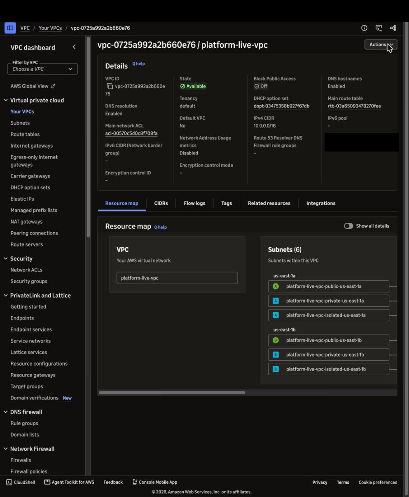
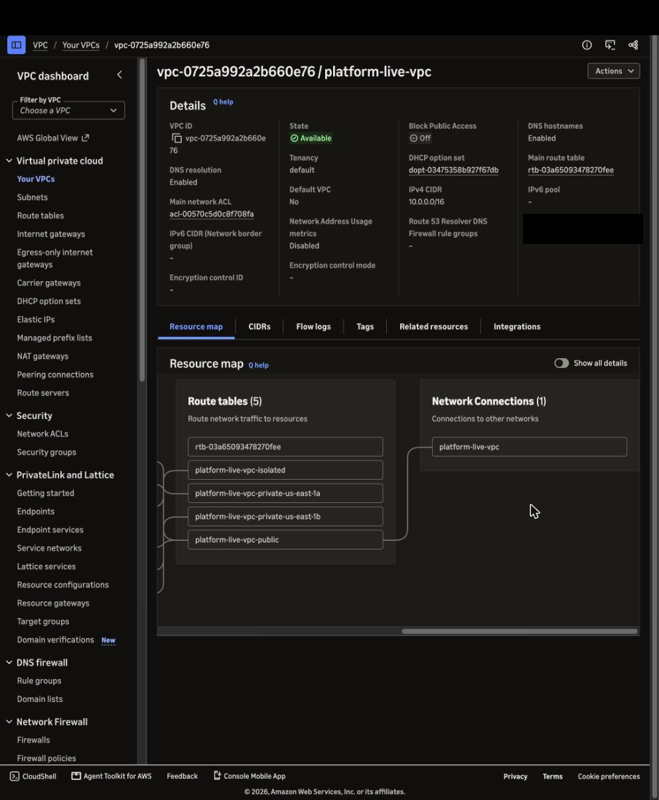
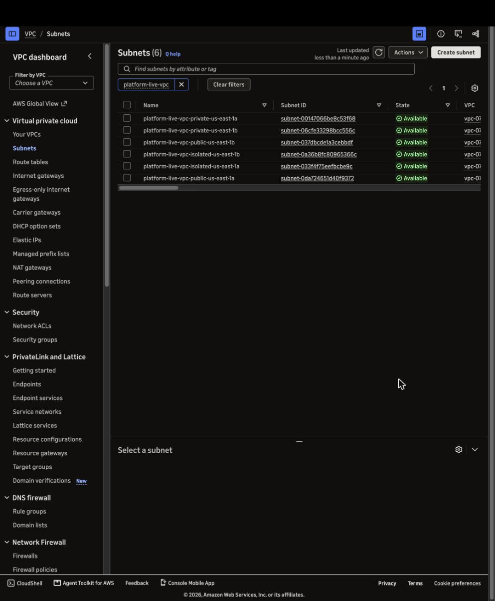
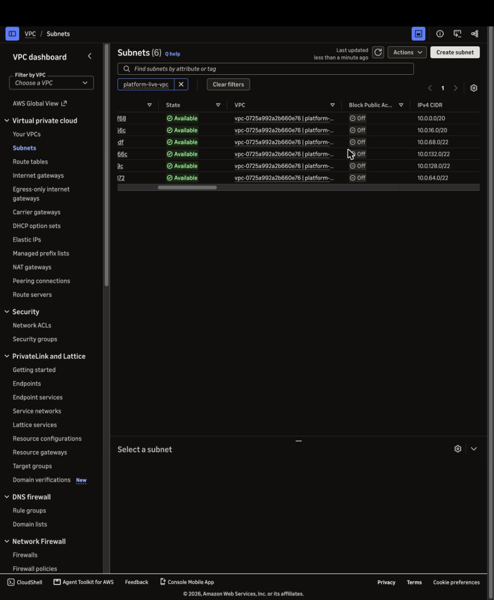
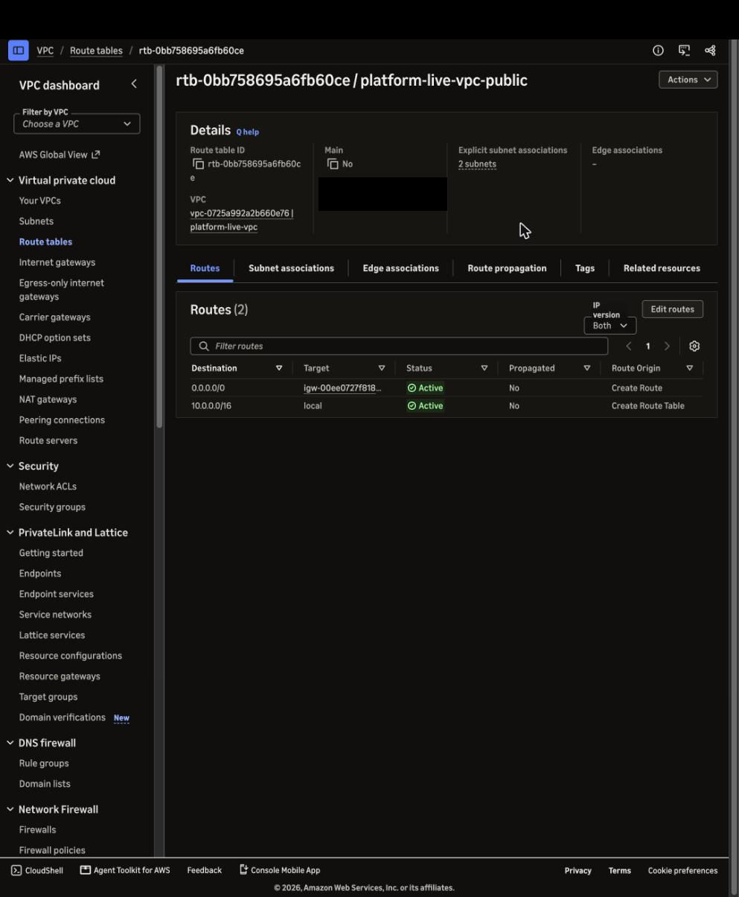
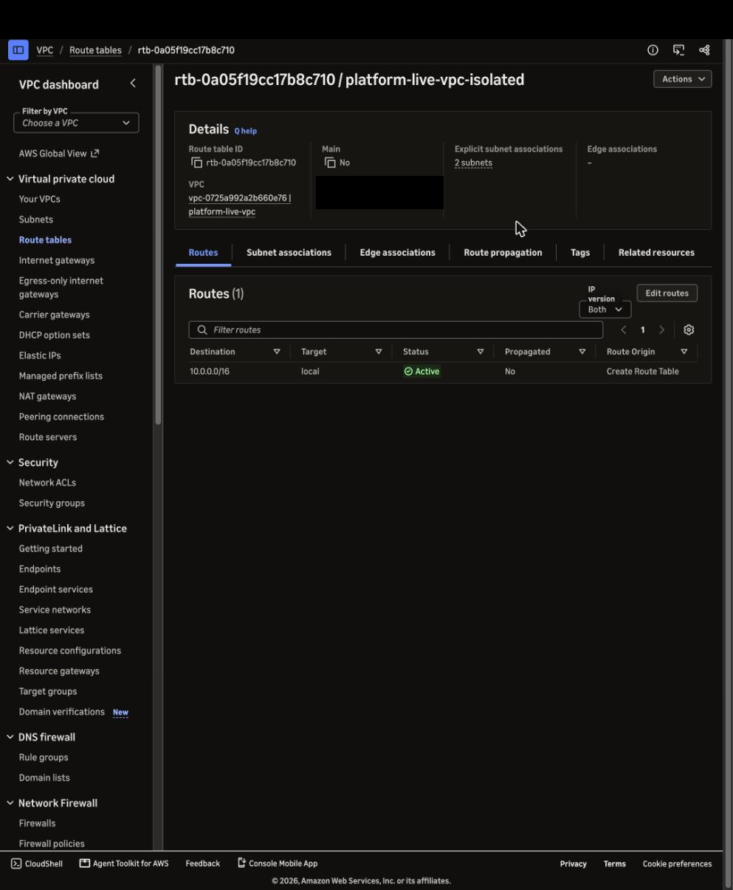
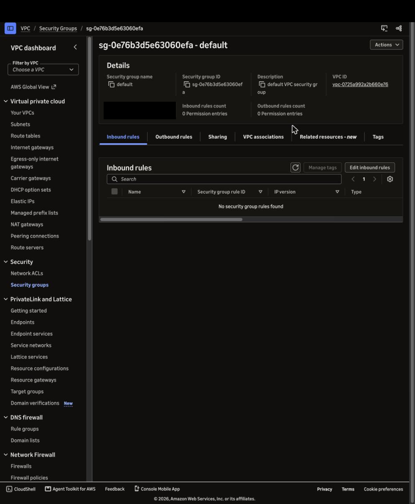
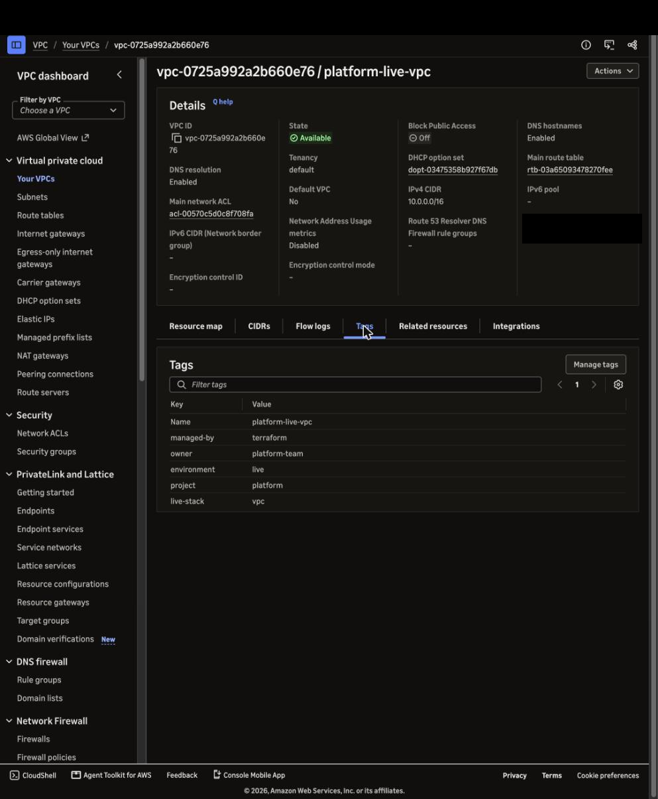

# Live drill: `vpc`, 2026-11-12

The first live drill: `live/stacks/vpc` applied to Rodrigo's real AWS account in `us-east-1` through
`.github/workflows/live-drill.yml`, looked at in the console, and destroyed again.

| | |
| --- | --- |
| Stack | `live/stacks/vpc` (calls `modules/vpc`, 2 Availability Zones, no NAT gateway) |
| Commit applied | `964806098046b6b98f0fb56d38016f75bd088ad2` |
| Run | [43333466143](https://github.com/rodrigopimenta10/aws-platform-terraform/actions/runs/43333466143) |
| Approved by | Rodrigo, both jobs (apply at 00:16 UTC, destroy at 00:17 UTC on 2026-11-13), in chat with Claude Code |
| Hold | 15 minutes |
| Apply | 13 s, 20 resources |
| Destroy | 11 s. The workflow's own check failed on stale index entries; verified by hand and by the fixed check (below) |
| Cost of the hold | $0 (see below) |

## What was created

From the job summary ([`evidence/summary.md`](2026-11-12-vpc/evidence/summary.md)):

| Type | Count |
| --- | --- |
| `aws_vpc` | 1 |
| `aws_subnet` | 6 |
| `aws_route_table` | 4 |
| `aws_route_table_association` | 6 |
| `aws_route` | 1 |
| `aws_internet_gateway` | 1 |
| `aws_default_security_group` | 1 |

A **VPC** (Virtual Private Cloud) is a private network inside AWS. A **subnet** is a slice of its address
range in one **Availability Zone** (AZ: one or more data centres in a region). A **route table** says where
traffic from a subnet may go; the **internet gateway** is the VPC's door to the internet.

## Screenshots

Captured from the console (signed in as the account's admin IAM user, not root), page area only. The console's
top bar and every account number ("Owner ID", "Owner") are blacked out.

**vpc-details**: VPC `platform-live-vpc`, `10.0.0.0/16`, DNS resolution and DNS hostnames enabled.

**resource-map**: the map's right half: 5 route tables (the VPC's main route table, which AWS creates with
every VPC, plus the stack's 4) and 1 network connection, the internet gateway. No NAT gateway. The left half
of the same map, with the 6 subnets in two AZs, is in the first screenshot.

**subnets**: 6 subnets named `platform-live-vpc-<tier>-<az>` (ADR 0002).

**subnets-cidrs**: the same list scrolled to the IPv4 CIDR column: private `/20`s, public and isolated `/22`s.

**public-route-table**: `0.0.0.0/0` goes to the internet gateway; associated with 2 subnets (both public ones).

**isolated-route-table**: only the local route. The isolated subnets have no way out of the VPC.

**default-security-group**: the VPC's default security group has 0 inbound and 0 outbound rules.

**tags**: the standard tags from ADR 0002 (`project`, `environment=live`, `owner`, `managed-by=terraform`) plus
`live-stack=vpc`, which the destroy check looks up.

## Evidence highlights

Read-only `aws` describe calls made by the workflow right after the apply, with the account ID replaced by
`<ACCOUNT_ID>`, in [`evidence/`](2026-11-12-vpc/evidence/).

- **VPC**: `10.0.0.0/16`, `EnableDnsSupport` true, `EnableDnsHostnames` true
  ([`vpc.json`](2026-11-12-vpc/evidence/vpc.json), [`vpc-dns-support.json`](2026-11-12-vpc/evidence/vpc-dns-support.json),
  [`vpc-dns-hostnames.json`](2026-11-12-vpc/evidence/vpc-dns-hostnames.json)).
- **Subnets** ([`subnets.json`](2026-11-12-vpc/evidence/subnets.json)), none of them giving out public IPs on launch:

  | Tier | us-east-1a | us-east-1b |
  | --- | --- | --- |
  | private | `10.0.0.0/20` | `10.0.16.0/20` |
  | public | `10.0.64.0/22` | `10.0.68.0/22` |
  | isolated | `10.0.128.0/22` | `10.0.132.0/22` |

- **Routes** ([`route-tables.json`](2026-11-12-vpc/evidence/route-tables.json)): the public route table has the
  local route and `0.0.0.0/0` to the internet gateway (2 subnets). The isolated one (2 subnets) and the two
  private ones (1 subnet each) have only the local route. The private subnets get their way out through NAT
  gateways in milestones that add them; this stack has none on purpose.
- **Default security group**: no inbound and no outbound rules ([`security-groups.json`](2026-11-12-vpc/evidence/security-groups.json)).
- **NAT gateways**: 0 ([`nat-gateways.json`](2026-11-12-vpc/evidence/nat-gateways.json)). **Internet gateways**: 1.

## What it cost

$0. Nothing in this stack is billed by the hour: AWS charges for NAT gateways, public IPv4 addresses and
similar, not for VPCs, subnets, route tables or internet gateways
([VPC pricing](https://aws.amazon.com/vpc/pricing/)). The stack has no NAT gateway and launches nothing with a
public IP. The only standing cost of live drills is the bootstrap's KMS key for the state bucket, about $1 a
month, which exists whether or not a drill runs.

## Destroy

The destroy job ran after the 15-minute hold, starting 00:37 UTC: `terraform destroy` succeeded in 11 s and
the stack's state in the bucket holds 0 resources. The job then **failed its "Verify nothing is left" step**
([`evidence/destroy.json`](2026-11-12-vpc/evidence/destroy.json): `destroy_outcome` success,
`destroy_verified` false). For five minutes the Resource Groups Tagging API kept listing two subnets and the
VPC's default security group as tagged `live-stack=vpc`.

Checked from the Mac at 00:39 UTC, as the admin user:
- `describe-subnets` and `describe-security-groups` answered `InvalidSubnetID.NotFound` and
  `InvalidGroup.NotFound` for all three.
- Searching EC2 itself by the tag `live-stack=vpc` found 0 VPCs, subnets, route tables, internet gateways and
  security groups, and there is no VPC in `us-east-1` other than the account's default one.
- The tagging index still listed them more than ten minutes after the destroy. EC2's own tag records
  (`describe-tags`) also still showed the two subnets.

So the index was stale, not the account. `live/verify-destroyed.sh` now asks for each listed resource
directly and counts an EC2 resource as gone on `<Type>.NotFound` (`fix(live): confirm each leftover with its own
service`). Run against the account afterwards, it says "the tagging index still lists resources for
live-stack=vpc, but EC2 says none of them exist" and passes. It still reports a resource that exists (tested
with a default-VPC subnet) and anything from a service it cannot check.

**Destroy verified**, by hand and by the fixed check. The workflow run itself shows as failed because of the
old check.

## What went differently

- **The first attempt was refused** (run [43331568356](https://github.com/rodrigopimenta10/aws-platform-terraform/actions/runs/43331568356)).
  AWS denied `sts:AssumeRoleWithWebIdentity` before anything was created: GitHub sent the token subject
  `repo:<owner>@<owner id>/<repo>@<repo id>:environment:aws-live`, and the role expected the older
  `repo:<owner>/<repo>:environment:aws-live`. CloudTrail showed the subject. The role now expects the form
  GitHub sends (`fix(live): match the OIDC subject GitHub sends`), applied to `live/bootstrap` the same night.
  The destroy job of that run was rejected, as there was nothing to destroy.
- **Screenshots** were captured with Claude in Chrome's page capture (the page area only, at the page's own
  size) rather than `screencapture`; the redaction step is the same.
- **The destroy check failed on a stale index**, as above, and was fixed after the drill.
- **The resource map** shows 5 route tables, not the 4 that `live/screenshots.yml` mentions: AWS creates a main
  route table with every VPC, and the stack leaves it unused.
