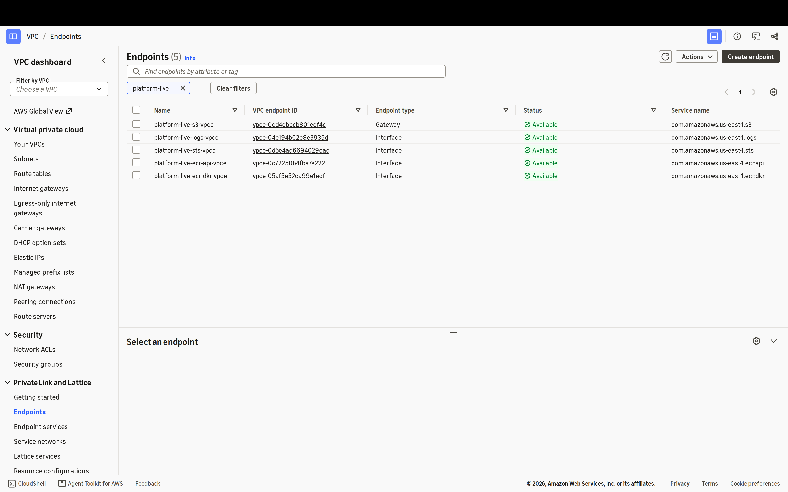
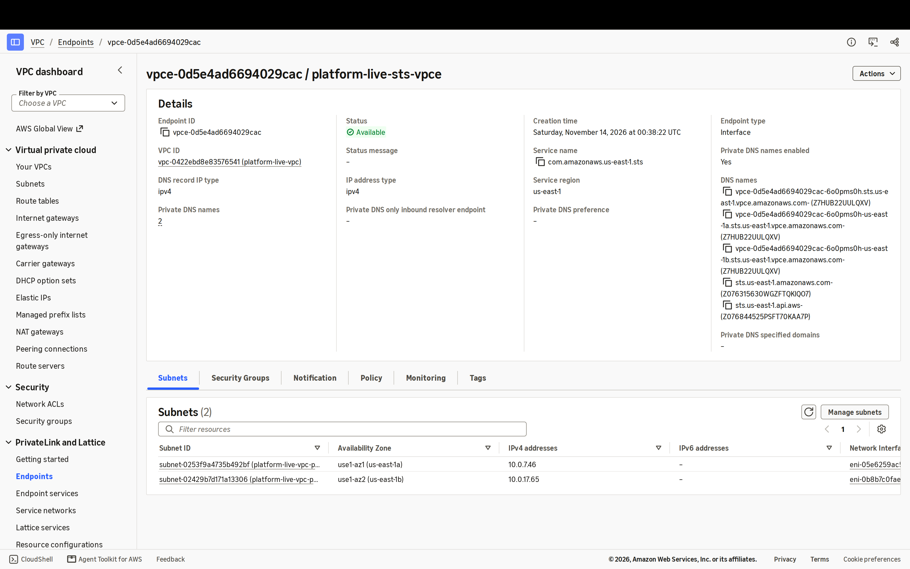
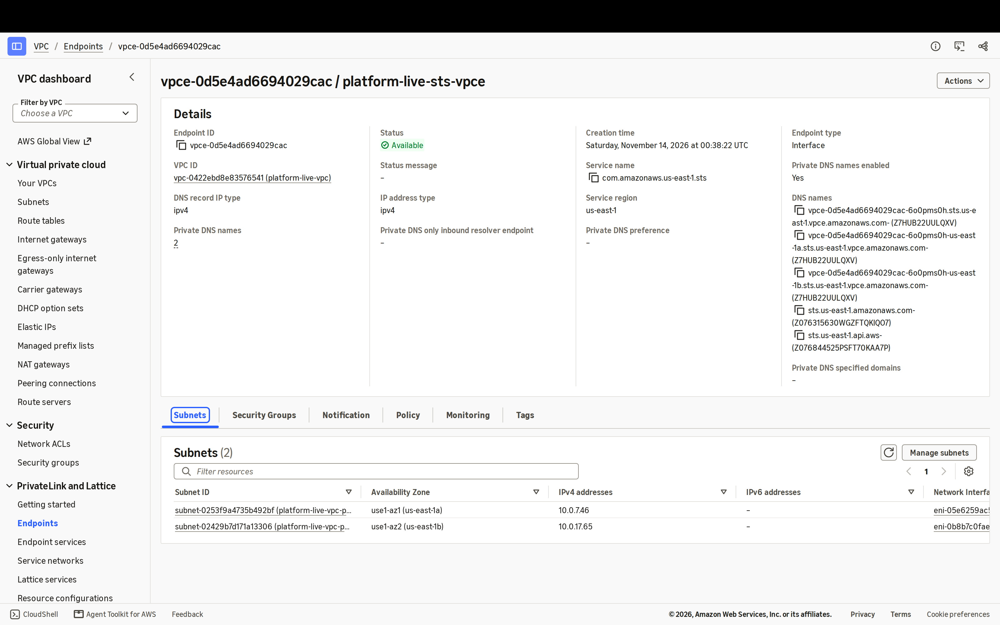
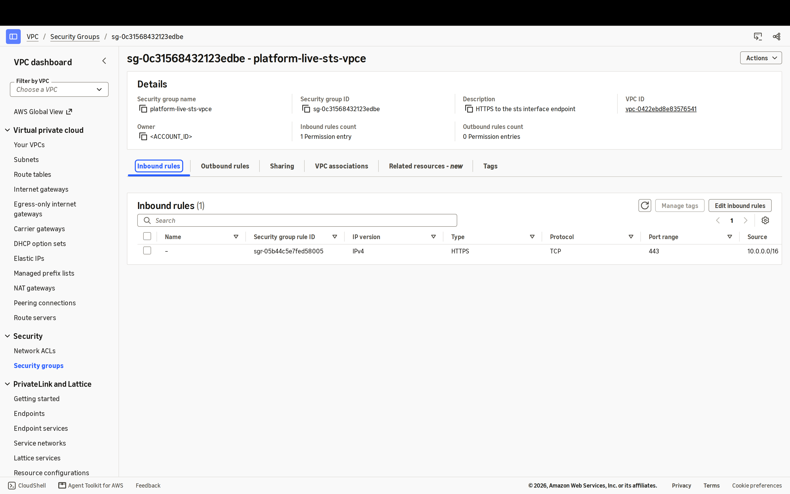
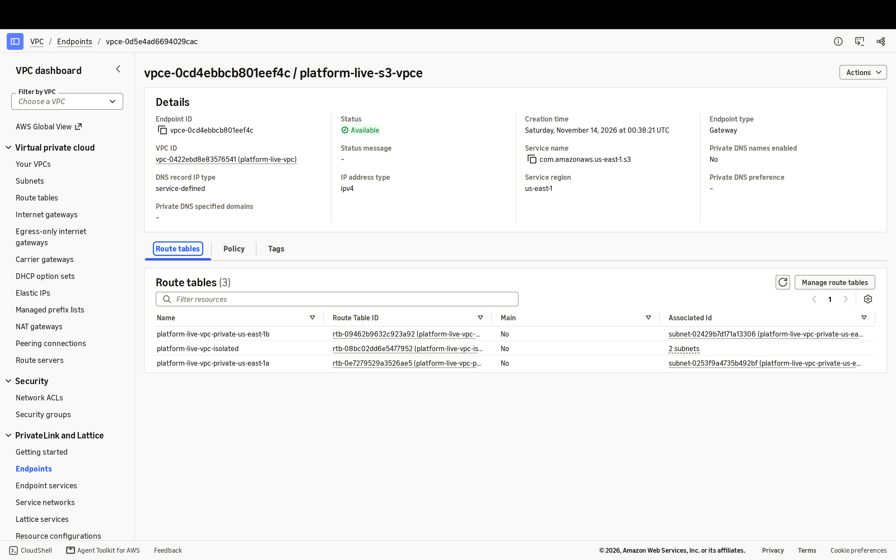

# Live drill: `m1`, 2026-11-13

Applied to the real AWS account by `.github/workflows/live-drill.yml` (changes since 1a6e1015dfa4),
screenshotted in a headless browser signed in as the drill role, then destroyed. No human step.

| | |
| --- | --- |
| Stack | `live/stacks/m1` |
| Commit applied | `0af21656c10aa5dadfbd7a35ac246a33b7ecead8` |
| Why it ran | changes since 1a6e1015dfa4 |
| Run | [43535362350](https://github.com/rodrigopimenta10/aws-platform-terraform/actions/runs/43535362350) |
| Plan gate | passed |
| Apply | success, 59 s, 33 resources |
| Destroy | success, 169 s |
| Destroy verified | **NO: check the account** |

## What was created

| Type | Count |
| --- | --- |
| `aws_default_security_group` | 1 |
| `aws_internet_gateway` | 1 |
| `aws_route` | 1 |
| `aws_route_table` | 4 |
| `aws_route_table_association` | 6 |
| `aws_security_group` | 4 |
| `aws_subnet` | 6 |
| `aws_vpc` | 1 |
| `aws_vpc_endpoint` | 5 |
| `aws_vpc_security_group_ingress_rule` | 4 |

## Screenshots

Captured at 2x device pixels in the AWS console, signed in through the AWS federation endpoint as the drill
role. Before each capture every occurrence of the account ID was replaced and the console header masked.

**endpoints** (3200x2000): 5 endpoints: the S3 gateway endpoint plus ECR api, ECR dkr, STS and Logs interface endpoints, all named platform-live-<service>-vpce

**sts-endpoint-details** (3200x2000): STS interface endpoint with private DNS names enabled, in the drill VPC

**sts-endpoint-subnets** (3200x2000): The endpoint has a network interface in each of the 2 private subnets

**sts-endpoint-security-group** (3200x2000): The endpoint's own security group allows only HTTPS (443) from 10.0.0.0/16

**s3-gateway-endpoint-routes** (3200x2000): The S3 gateway endpoint is attached to both private route tables and the isolated one

## Evidence

Read-only describe calls right after the apply, account ID replaced by `<ACCOUNT_ID>`:
- [`outputs.json`](2026-11-13-m1/evidence/outputs.json)
- [`state-list.txt`](2026-11-13-m1/evidence/state-list.txt)
- [`summary.md`](2026-11-13-m1/evidence/summary.md)
- [`tagged-resources.json`](2026-11-13-m1/evidence/tagged-resources.json)
