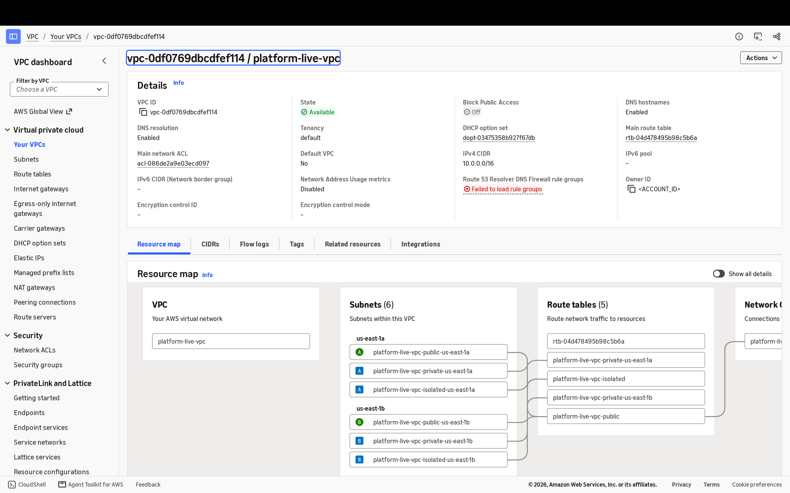
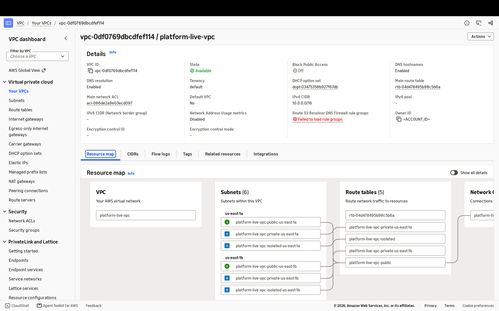
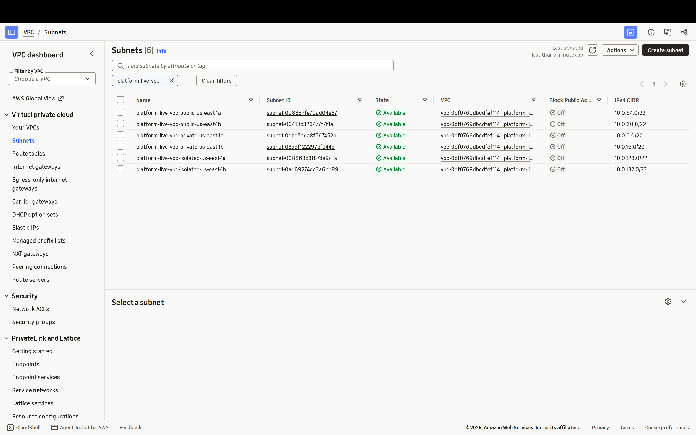
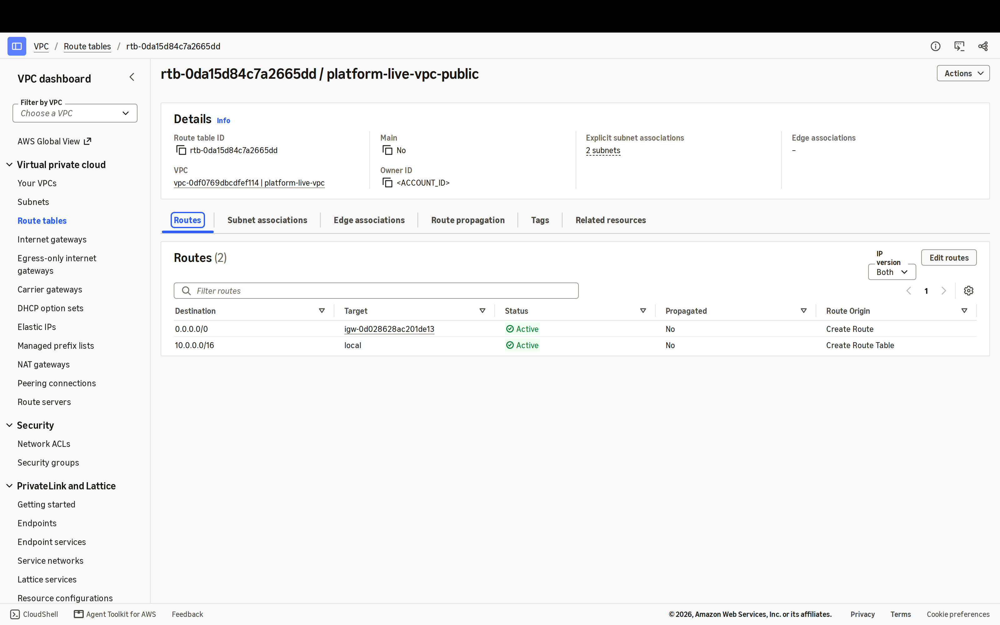
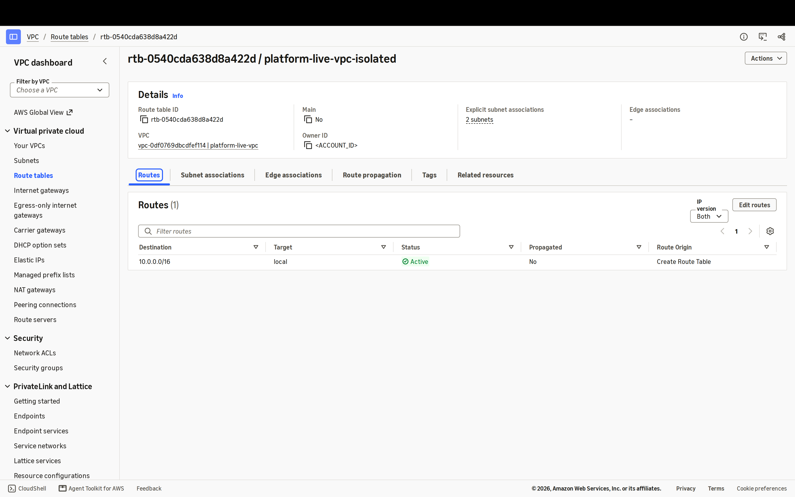
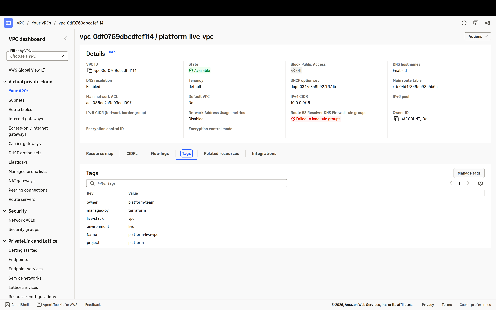

# Live drill: `vpc`, 2026-11-13

Applied to the real AWS account by `.github/workflows/live-drill.yml` (changes since 1a6e1015dfa4),
screenshotted in a headless browser signed in as the drill role, then destroyed. No human step.

| | |
| --- | --- |
| Stack | `live/stacks/vpc` |
| Commit applied | `0af21656c10aa5dadfbd7a35ac246a33b7ecead8` |
| Why it ran | changes since 1a6e1015dfa4 |
| Run | [43535362350](https://github.com/rodrigopimenta10/aws-platform-terraform/actions/runs/43535362350) |
| Plan gate | passed |
| Apply | success, 11 s, 20 resources |
| Destroy | success, 8 s |
| Destroy verified | **yes** |

## What was created

| Type | Count |
| --- | --- |
| `aws_default_security_group` | 1 |
| `aws_internet_gateway` | 1 |
| `aws_route` | 1 |
| `aws_route_table` | 4 |
| `aws_route_table_association` | 6 |
| `aws_subnet` | 6 |
| `aws_vpc` | 1 |

## Screenshots

Captured at 2x device pixels in the AWS console, signed in through the AWS federation endpoint as the drill
role. Before each capture every occurrence of the account ID was replaced and the console header masked.

**vpc-details** (3200x2000): VPC platform-live-vpc, 10.0.0.0/16, DNS resolution and DNS hostnames enabled

**resource-map** (3200x2000): 2 AZs x 3 tiers = 6 subnets, the stack's route tables, 1 internet gateway, no NAT gateway

**subnets** (3200x2000): 6 subnets named platform-live-vpc-<tier>-<az> (ADR 0002): private /20s, public and isolated /22s

**public-route-table** (3200x2000): 0.0.0.0/0 goes to the internet gateway; associated with both public subnets

**isolated-route-table** (3200x2000): Only the local route: isolated subnets have no way out of the VPC

**tags** (3200x2000): Standard tags from ADR 0002 (project, environment=live, owner, managed-by) plus live-stack=vpc

## Evidence

Read-only describe calls right after the apply, account ID replaced by `<ACCOUNT_ID>`:
- [`internet-gateways.json`](2026-11-13-vpc-3/evidence/internet-gateways.json)
- [`nat-gateways.json`](2026-11-13-vpc-3/evidence/nat-gateways.json)
- [`outputs.json`](2026-11-13-vpc-3/evidence/outputs.json)
- [`route-tables.json`](2026-11-13-vpc-3/evidence/route-tables.json)
- [`security-groups.json`](2026-11-13-vpc-3/evidence/security-groups.json)
- [`state-list.txt`](2026-11-13-vpc-3/evidence/state-list.txt)
- [`subnets.json`](2026-11-13-vpc-3/evidence/subnets.json)
- [`summary.md`](2026-11-13-vpc-3/evidence/summary.md)
- [`tagged-resources.json`](2026-11-13-vpc-3/evidence/tagged-resources.json)
- [`vpc-dns-hostnames.json`](2026-11-13-vpc-3/evidence/vpc-dns-hostnames.json)
- [`vpc-dns-support.json`](2026-11-13-vpc-3/evidence/vpc-dns-support.json)
- [`vpc.json`](2026-11-13-vpc-3/evidence/vpc.json)
