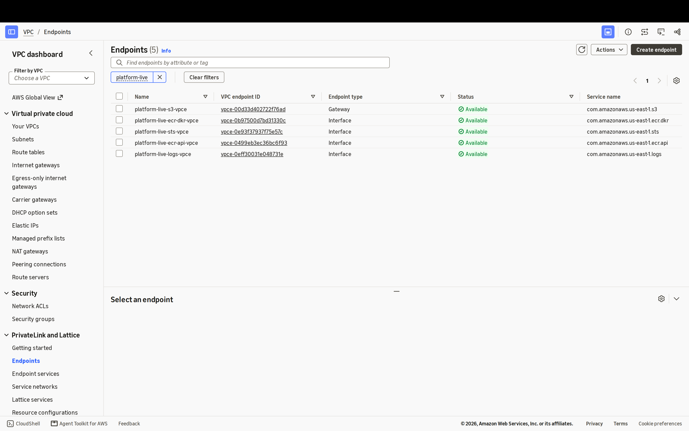
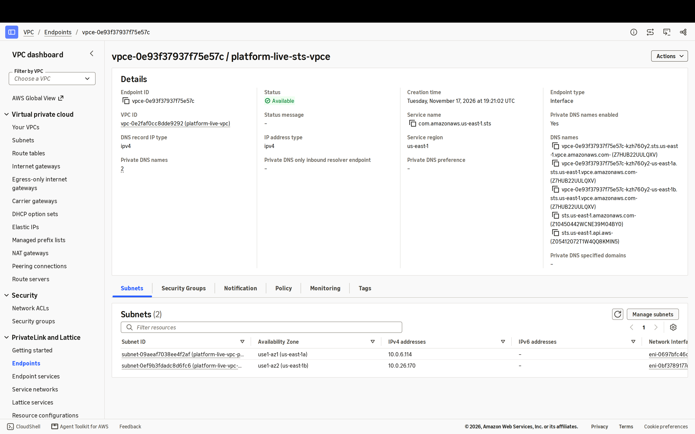
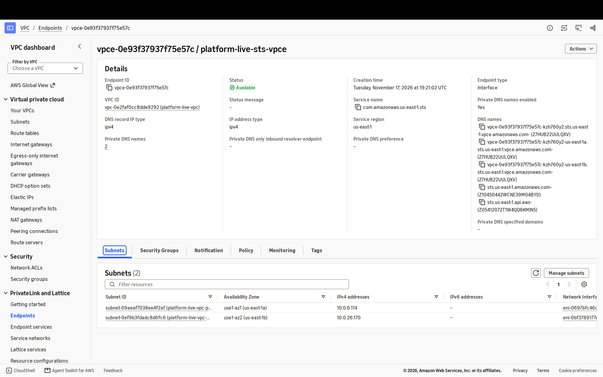
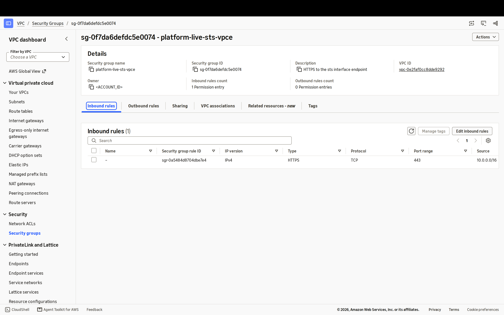
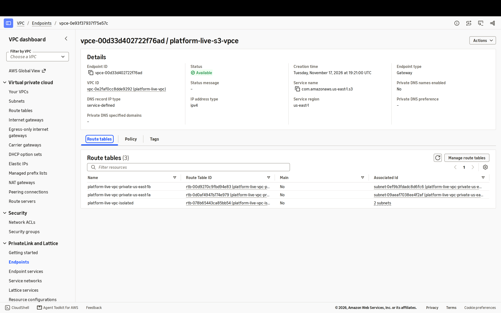
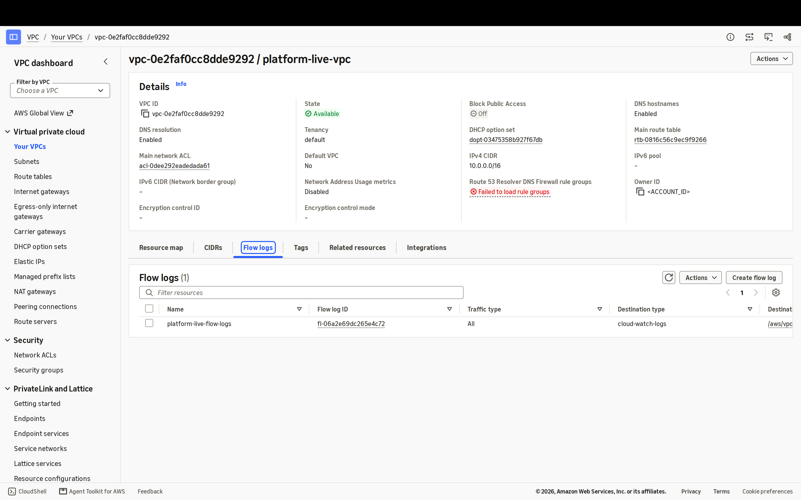
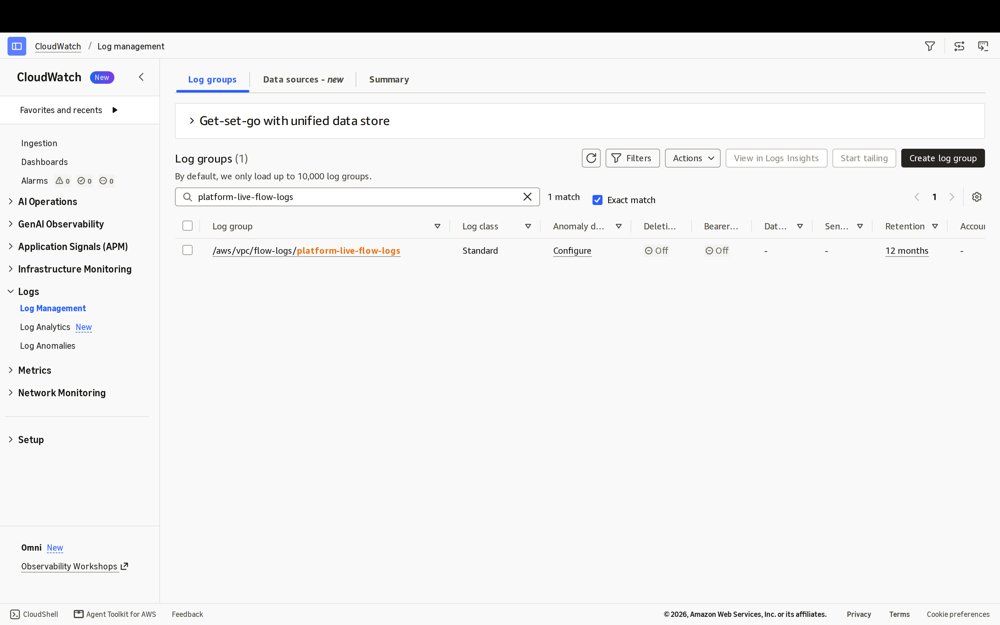

# Live drill: `m1`, 2026-11-17

Applied to the real AWS account by `.github/workflows/live-drill.yml` (started by hand),
screenshotted in a headless browser signed in as the drill role, then destroyed. No human step.

| | |
| --- | --- |
| Stack | `live/stacks/m1` |
| Commit applied | `c5f39172cc3582383de4400031eea46c42fe4c75` |
| Why it ran | started by hand |
| Run | [44157419333](https://github.com/rodrigopimenta10/aws-platform-terraform/actions/runs/44157419333) |
| Plan gate | passed |
| Apply | success, 70 s, 39 resources |
| Destroy | success, 259 s |
| Destroy verified | **yes** |

## What was created

| Type | Count |
| --- | --- |
| `aws_cloudwatch_log_group` | 1 |
| `aws_default_security_group` | 1 |
| `aws_flow_log` | 1 |
| `aws_iam_role` | 1 |
| `aws_iam_role_policy` | 1 |
| `aws_internet_gateway` | 1 |
| `aws_kms_alias` | 1 |
| `aws_kms_key` | 1 |
| `aws_route` | 1 |
| `aws_route_table` | 4 |
| `aws_route_table_association` | 6 |
| `aws_security_group` | 4 |
| `aws_subnet` | 6 |
| `aws_vpc` | 1 |
| `aws_vpc_endpoint` | 5 |
| `aws_vpc_security_group_ingress_rule` | 4 |

## Screenshots

Captured at 2x device pixels in the AWS console, signed in through the AWS federation endpoint as the drill
role. Before each capture every occurrence of the account ID was replaced and the console header masked.

**endpoints** (3200x2000): 5 endpoints: the S3 gateway endpoint plus ECR api, ECR dkr, STS and Logs interface endpoints, all named platform-live-<service>-vpce

**sts-endpoint-details** (3200x2000): STS interface endpoint with private DNS names enabled, in the drill VPC

**sts-endpoint-subnets** (3200x2000): The endpoint has a network interface in each of the 2 private subnets

**sts-endpoint-security-group** (3200x2000): The endpoint's own security group allows only HTTPS (443) from 10.0.0.0/16

**s3-gateway-endpoint-routes** (3200x2000): The S3 gateway endpoint is attached to both private route tables and the isolated one

**vpc-flow-logs** (3200x2000): A flow log on the VPC: filter ALL, destination type CloudWatch Logs, destination the platform-live-flow-logs log group, status Active

**flow-log-group** (3200x2000): The log group /aws/vpc/flow-logs/platform-live-flow-logs with 1 year retention and a KMS key ID shown

## Evidence

Read-only describe calls right after the apply, account ID replaced by `<ACCOUNT_ID>`:
- [`outputs.json`](2026-11-17-m1-2/evidence/outputs.json)
- [`state-list.txt`](2026-11-17-m1-2/evidence/state-list.txt)
- [`summary.md`](2026-11-17-m1-2/evidence/summary.md)
- [`tagged-resources.json`](2026-11-17-m1-2/evidence/tagged-resources.json)
