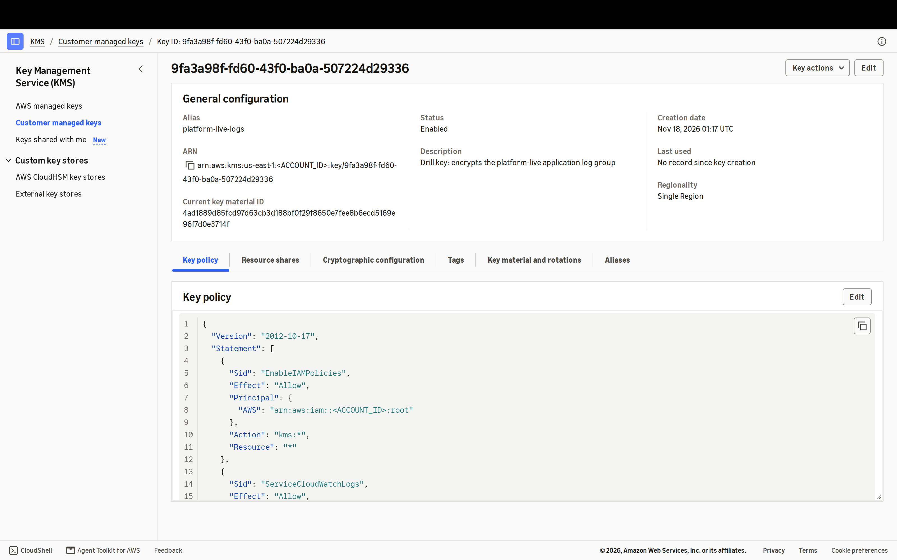
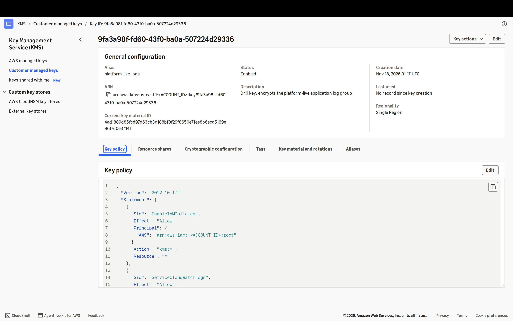
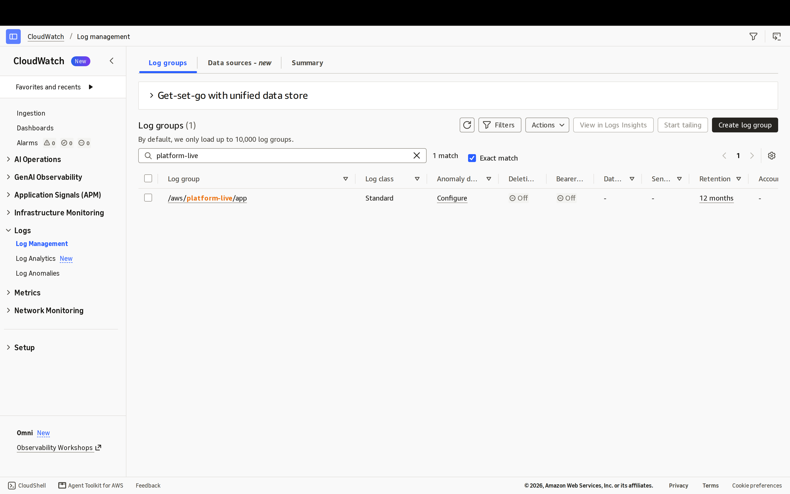
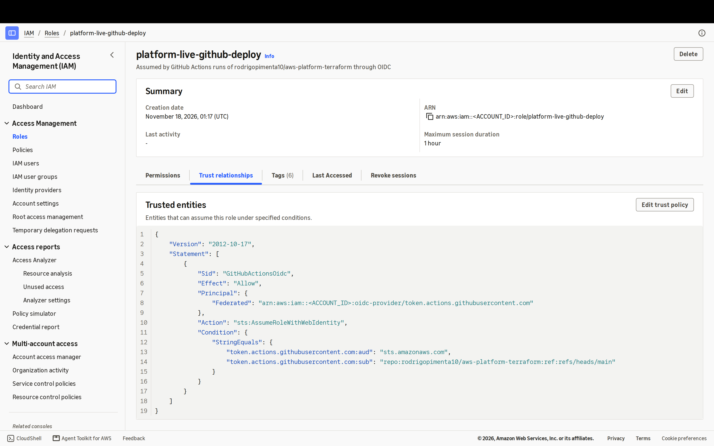
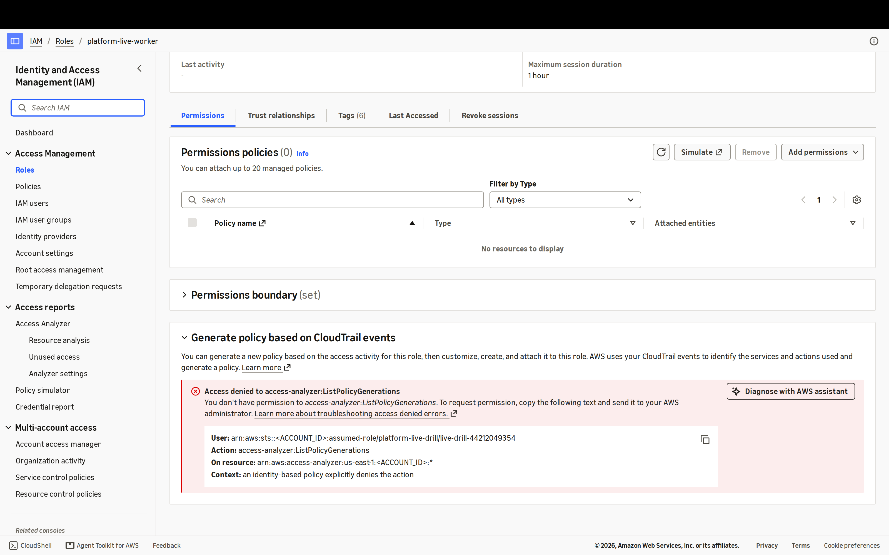

# Live drill: `m2`, 2026-11-17

Applied to the real AWS account by `.github/workflows/live-drill.yml` (changes since 4388814c1720),
screenshotted in a headless browser signed in as the drill role, then destroyed. No human step.

| | |
| --- | --- |
| Stack | `live/stacks/m2` |
| Commit applied | `83987fbaec371d68b4bf8be277fd759ad8af6324` |
| Why it ran | changes since 4388814c1720 |
| Run | [44212049354](https://github.com/rodrigopimenta10/aws-platform-terraform/actions/runs/44212049354) |
| Plan gate | passed |
| Apply | success, 20 s, 6 resources |
| Destroy | success, 8 s |
| Destroy verified | **yes** |

## What was created

| Type | Count |
| --- | --- |
| `aws_cloudwatch_log_group` | 1 |
| `aws_iam_policy` | 1 |
| `aws_iam_role` | 2 |
| `aws_kms_alias` | 1 |
| `aws_kms_key` | 1 |

## Screenshots

Captured at 2x device pixels in the AWS console, signed in through the AWS federation endpoint as the drill
role. Before each capture every occurrence of the account ID was replaced and the console header masked.

**kms-key** (3200x2000): Customer-managed symmetric key with alias platform-live-logs, enabled, with automatic rotation shown as enabled

**kms-key-policy** (3200x2000): The key policy has the account root delegation statement and a CloudWatch Logs statement limited by an encryption context

**log-group-uses-key** (3200x2000): The log group /aws/platform-live/app with 1 year retention and the drill KMS key ID shown

**github-role-trust** (3200x2000): Role platform-live-github-deploy trusts the GitHub OIDC provider with audience sts.amazonaws.com and only this repository's refs/heads/main as subject

**worker-role-boundary** (3200x2000): Role platform-live-worker has no permission policies and shows the permissions boundary platform-live-drill-boundary

## Evidence

Read-only describe calls right after the apply, account ID replaced by `<ACCOUNT_ID>`:
- [`outputs.json`](2026-11-17-m2-4/evidence/outputs.json)
- [`state-list.txt`](2026-11-17-m2-4/evidence/state-list.txt)
- [`summary.md`](2026-11-17-m2-4/evidence/summary.md)
- [`tagged-resources.json`](2026-11-17-m2-4/evidence/tagged-resources.json)
