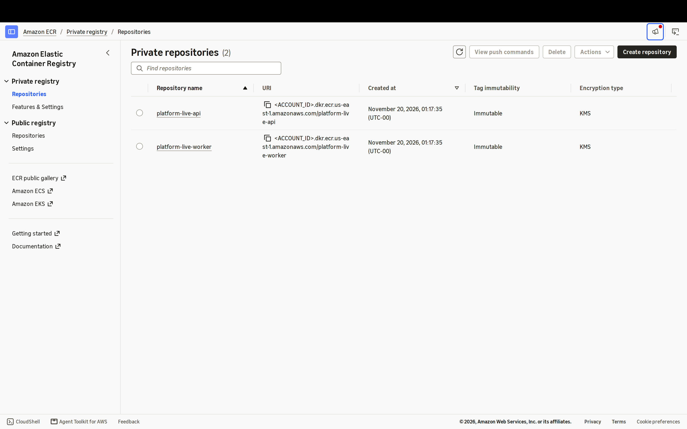
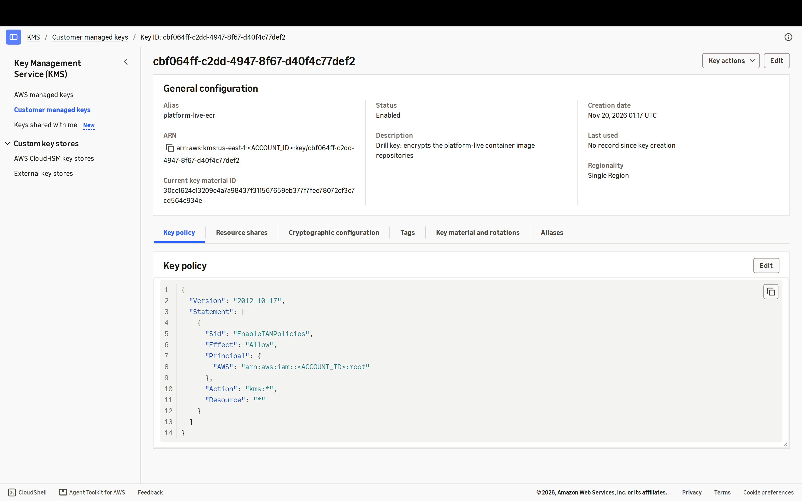

# Live drill: `m3`, 2026-11-19

Applied to the real AWS account by `.github/workflows/live-drill.yml` (changes since 30e32f613bd1),
screenshotted in a headless browser signed in as the drill role, then destroyed. No human step.

| | |
| --- | --- |
| Stack | `live/stacks/m3` |
| Commit applied | `65b000c9a0d79a0e39e52d94d3ce14d9c3f93a5e` |
| Why it ran | changes since 30e32f613bd1 |
| Run | [44649986792](https://github.com/rodrigopimenta10/aws-platform-terraform/actions/runs/44649986792) |
| Plan gate | passed |
| Apply | success, 16 s, 6 resources |
| Destroy | success, 5 s |
| Destroy verified | **yes** |

## What was created

| Type | Count |
| --- | --- |
| `aws_ecr_lifecycle_policy` | 2 |
| `aws_ecr_repository` | 2 |
| `aws_kms_alias` | 1 |
| `aws_kms_key` | 1 |

## Screenshots

Captured at 2x device pixels in the AWS console, signed in through the AWS federation endpoint as the drill
role. Before each capture every occurrence of the account ID was replaced and the console header masked.

**ecr-repositories** (3200x2000): Private repositories platform-live-api and platform-live-worker, both with Immutable tag mutability and KMS encryption

**ecr-key** (3200x2000): The customer-managed key alias platform-live-ecr that encrypts both repositories, enabled, with automatic rotation shown as enabled

## Evidence

Read-only describe calls right after the apply, account ID replaced by `<ACCOUNT_ID>`:
- [`outputs.json`](2026-11-19-m3/evidence/outputs.json)
- [`state-list.txt`](2026-11-19-m3/evidence/state-list.txt)
- [`summary.md`](2026-11-19-m3/evidence/summary.md)
- [`tagged-resources.json`](2026-11-19-m3/evidence/tagged-resources.json)
