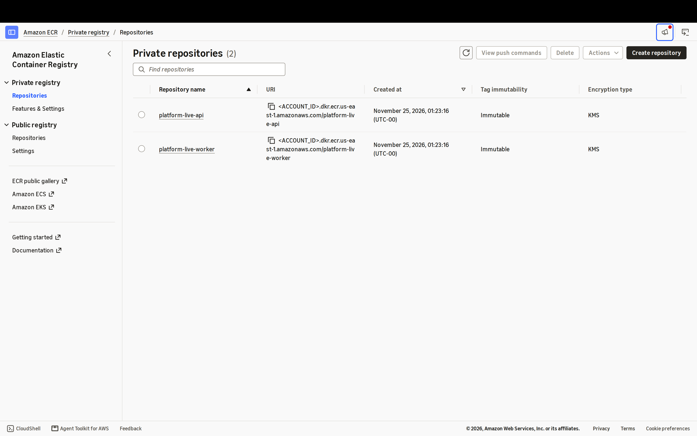
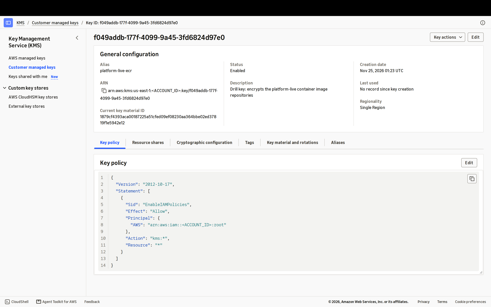
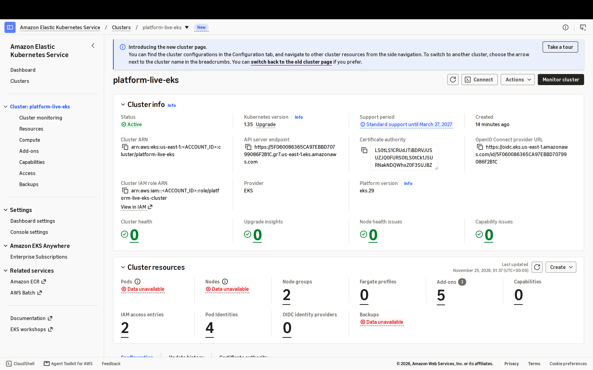
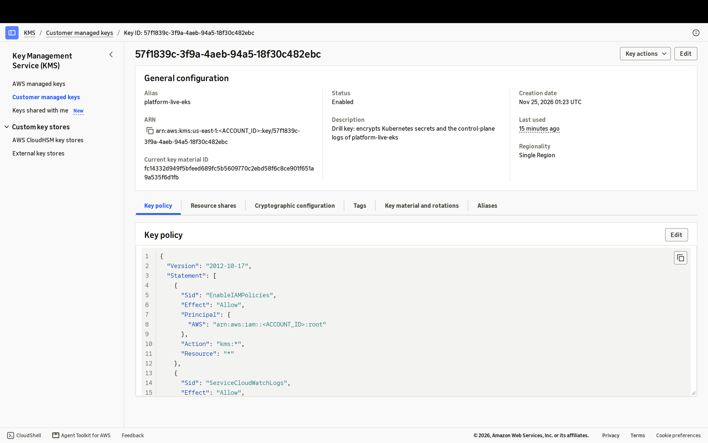
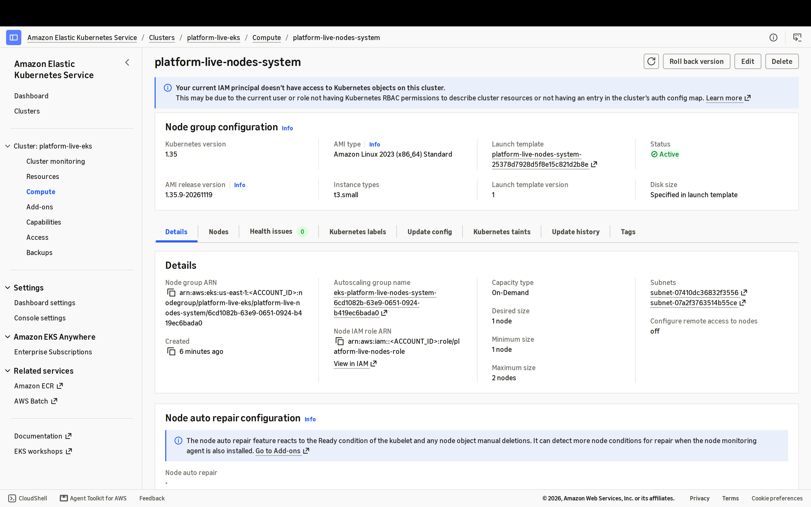

# Live drill: `m3`, 2026-11-24

Applied to the real AWS account by `.github/workflows/live-drill.yml` (changes since 9194ed12fc20),
screenshotted in a headless browser signed in as the drill role, then destroyed. No human step.

| | |
| --- | --- |
| Stack | `live/stacks/m3` |
| Commit applied | `beb9ddd7c1f6dc8b5534475cbd9d684e21e9a34a` |
| Why it ran | changes since 9194ed12fc20 |
| Run | [45523740054](https://github.com/rodrigopimenta10/aws-platform-terraform/actions/runs/45523740054) |
| Plan gate | passed |
| Apply | success, 832 s, 63 resources |
| Destroy | success, 311 s |
| Destroy verified | **yes** |

## What was created

| Type | Count |
| --- | --- |
| `aws_cloudwatch_log_group` | 1 |
| `aws_default_security_group` | 1 |
| `aws_ecr_lifecycle_policy` | 2 |
| `aws_ecr_repository` | 2 |
| `aws_eip` | 1 |
| `aws_eks_addon` | 5 |
| `aws_eks_cluster` | 1 |
| `aws_eks_node_group` | 2 |
| `aws_eks_pod_identity_association` | 3 |
| `aws_iam_policy` | 2 |
| `aws_iam_role` | 6 |
| `aws_iam_role_policy` | 3 |
| `aws_iam_role_policy_attachment` | 5 |
| `aws_internet_gateway` | 1 |
| `aws_kms_alias` | 2 |
| `aws_kms_key` | 2 |
| `aws_launch_template` | 2 |
| `aws_nat_gateway` | 1 |
| `aws_route` | 3 |
| `aws_route_table` | 4 |
| `aws_route_table_association` | 6 |
| `aws_subnet` | 6 |
| `aws_vpc` | 1 |
| `terraform_data` | 1 |

## Screenshots

Captured at 2x device pixels in the AWS console, signed in through the AWS federation endpoint as the drill
role. Before each capture every occurrence of the account ID was replaced and the console header masked.

**ecr-repositories** (3200x2000): Private repositories platform-live-api and platform-live-worker, both with Immutable tag mutability and KMS encryption

**ecr-key** (3200x2000): The customer-managed key alias platform-live-ecr that encrypts both repositories, enabled, with automatic rotation shown as enabled

**eks-cluster** (3200x2000): Cluster platform-live-eks is Active, runs the pinned Kubernetes version, and shows secrets encryption enabled with the customer-managed key

**eks-networking**: not captured (not found in any frame within 45s). Should show: API server endpoint access is Private, in the stack's two private subnets, with the cluster security group

**eks-key** (3200x2000): The customer-managed key alias platform-live-eks, enabled, with automatic rotation shown as enabled

**eks-compute**: not captured (not found in any frame within 45s). Should show: Node groups platform-live-nodes-system (On-Demand) and platform-live-nodes-batch (Spot), the first Active with one node

**eks-node-group** (3200x2000): Node group platform-live-nodes-system is Active on t3.small with scaling 1 to 2, the workload=system label and the node-group launch template

**eks-addons**: not captured (not found in any frame within 45s). Should show: Add-ons vpc-cni, coredns, kube-proxy, eks-pod-identity-agent and aws-ebs-csi-driver are installed, Active and on the versions the stack pinned

**eks-pod-identity**: not captured (not found in any frame within 45s). Should show: A Pod Identity association links service account orders-api in namespace orders to the role platform-live-orders

**eks-controller-policies**: not captured (not found in any frame within 45s). Should show: Customer-managed policies platform-live-lb-controller and platform-live-karpenter exist next to the boundary policy

## Evidence

Read-only describe calls right after the apply, account ID replaced by `<ACCOUNT_ID>`:
- [`outputs.json`](2026-11-24-m3-2/evidence/outputs.json)
- [`state-list.txt`](2026-11-24-m3-2/evidence/state-list.txt)
- [`summary.md`](2026-11-24-m3-2/evidence/summary.md)
- [`tagged-resources.json`](2026-11-24-m3-2/evidence/tagged-resources.json)
