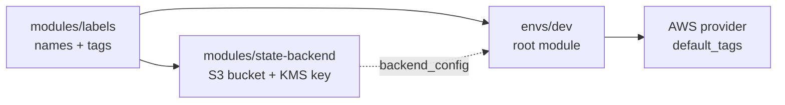

# Milestone M0 recap: Foundations

## How the pieces fit



`labels` creates nothing; it computes the `<project>-<environment>-<component>` names and the four standard
tags that everything else reuses. `state-backend` builds the encrypted, versioned, private S3 bucket (and its
KMS key) where Terraform keeps state, locking with S3 itself rather than DynamoDB. `envs/dev` is the root
module you actually run: it calls `labels`, passes the tags to the provider as `default_tags`, and carries a
commented-out backend block that points at the bucket once it exists. Later milestones add resources to
`envs/dev` and reuse `labels` for every name.

## Ten questions

<details><summary>1. Why does every module take names and tags from `labels`?</summary>

One convention means resources are findable, IAM policies can match name prefixes, and cost can be attributed by tag. Standard tags are merged last, so callers cannot override them.

</details>

<details><summary>2. What is Terraform state and why is it stored remotely?</summary>

It maps your configuration to real resources. Remote storage shares it between people and CI, and adds versioning, encryption and locking.

</details>

<details><summary>3. How does S3 native locking work?</summary>

With `use_lockfile`, Terraform writes a `.tflock` object using a conditional write that fails if the object exists, so only one run holds the lock.

</details>

<details><summary>4. Why a customer-managed KMS key for the state bucket?</summary>

You control its policy and rotation, reads need KMS permission as well as S3, and use is logged in CloudTrail.

</details>

<details><summary>5. What do the four public access block settings do together?</summary>

They ignore and block public ACLs and public bucket policies, so the bucket cannot become public by accident.

</details>

<details><summary>6. What does the TLS-only bucket policy do, and why does an explicit Deny matter?</summary>

It denies requests where `aws:SecureTransport` is false. An explicit Deny overrides any Allow.

</details>

<details><summary>7. Why is `force_destroy` false by default?</summary>

A stray `terraform destroy` should not be able to delete the only record of your infrastructure.

</details>

<details><summary>8. What is the bootstrapping catch-22 and how do you escape it?</summary>

The state bucket needs state to be created. Apply it with local state, then enable the backend block and run `terraform init -migrate-state`.

</details>

<details><summary>9. Why is `environment` hard-coded in `envs/dev` and why one root module per environment?</summary>

Separate state and blast radius per environment, and `dev` code can never be applied as `prod` by a wrong variable.

</details>

<details><summary>10. Why can the unit tests use `mock_provider` but the lifecycle rule bug only showed in Moto?</summary>

Mocks never read real behavior back. Moto emulates the API, so a setting it does not return made the provider's read-after-write polling hang.

</details>

## Apply it for real

You run this yourself, in a sandbox AWS account. Agents in this repo never do.

1. Use credentials for a **non-production** account (for example via `aws sso login`) and `export AWS_REGION=us-east-1`.
2. Create a scratch folder, call the module, and apply with local state:
   ```hcl
   module "state_backend" {
     source      = "../modules/state-backend"
     project     = "platform"
     environment = "dev"
     owner       = "platform-team"
   }
   output "backend_config" { value = module.state_backend.backend_config }
   ```
   ```bash
   terraform init && terraform apply
   terraform output backend_config
   ```
3. In `envs/dev/main.tf`, uncomment the backend block, fill in the output values, then:
   ```bash
   cd envs/dev && terraform init -migrate-state && terraform plan
   ```
4. **Console:** S3 → the bucket (versioning on, default encryption SSE-KMS, Block Public Access all on, a
   `.tflock` object appears during runs); KMS → Customer managed keys (rotation enabled).
5. **Cost:** about $0.001 per hour for the KMS key ($1/month) plus pennies of S3 storage. Nothing else.
6. **Verify:** `aws s3api get-bucket-versioning --bucket <name>` and
   `aws s3api get-public-access-block --bucket <name>`.
7. **Destroy:** the bucket has `force_destroy = false`. Set `force_destroy = true`, apply, delete versions or
   let it empty the bucket, then `terraform destroy`. The KMS key enters a deletion window (7+ days) and stops
   billing when deleted.
