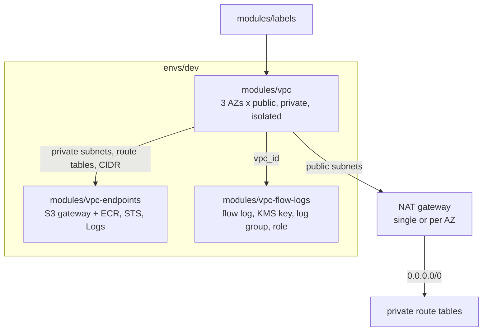

# Milestone M1 recap: Network

## How the pieces fit



`vpc` cuts the address range into three tiers across three availability zones: **public** subnets route to
an internet gateway, **private** subnets reach the internet only outbound through a NAT gateway, and
**isolated** subnets have no internet route at all. A variable chooses one shared NAT gateway or one per AZ
(ADR 0004, cost against availability). `vpc-endpoints` lets the private and isolated tiers reach S3, ECR,
STS and CloudWatch Logs privately, so those calls need no NAT. `vpc-flow-logs` records every connection into
an encrypted log group so you can see what the network allowed and blocked. `envs/dev` wires the three
together; the same wiring runs as the `m1` live-drill stack.

Latest drill evidence: [m1 on 2026-11-13](../live/2026-11-13-m1.md) (VPC and endpoints; the flow logs
arrive in the next drill, started by the push that carries this recap). Its destroy check reported "NO"
though Terraform's state was empty, so please confirm in the console.

## Ten questions

<details><summary>1. What makes a subnet public, private or isolated?</summary>

Its route table. Public has `0.0.0.0/0` to an internet gateway, private has it to a NAT gateway, isolated has no default route.

</details>

<details><summary>2. Why one private route table per AZ?</summary>

So each AZ can point at its own NAT gateway, and an AZ outage does not cut off the others when you run one NAT per AZ.

</details>

<details><summary>3. What does <code>cidrsubnet("10.0.0.0/16", 4, 2)</code> return?</summary>

`10.0.32.0/20`: add 4 bits to the prefix (/20) and take network number 2, each /20 spanning 16 in the third octet.

</details>

<details><summary>4. Why must a NAT gateway sit in a public subnet?</summary>

It needs its own route to an internet gateway to forward translated traffic out.

</details>

<details><summary>5. One NAT or one per AZ?</summary>

One is about a third of the cost but is a single point of failure, and cross-AZ traffic is billed. One per AZ costs more and survives an AZ failure.

</details>

<details><summary>6. Gateway versus interface endpoint?</summary>

A gateway endpoint (S3, DynamoDB) is a free route-table entry. An interface endpoint is a network interface with a private IP and private DNS, billed per AZ-hour and per GB.

</details>

<details><summary>7. A private node cannot pull from ECR although the ECR endpoints exist. What do you check?</summary>

The S3 gateway endpoint and its route tables (layers come from S3), private DNS on both ECR endpoints, the endpoint security group allowing 443 from the node, and DNS support on the VPC.

</details>

<details><summary>8. When are interface endpoints cheaper than NAT?</summary>

When much AWS-service traffic would otherwise pay NAT's per-GB charge. With little traffic the hourly endpoint charge costs more, and the reason becomes private-only networking.

</details>

<details><summary>9. How do you keep a KMS key for one log group from serving others?</summary>

A key-policy condition on the encryption context `aws:logs:arn` for that log group.

</details>

<details><summary>10. Why do the <code>envs/dev</code> tests assert on outputs, not on resources inside modules?</summary>

A root module only sees its children's outputs. Resources inside a module are not addressable from the caller or its tests.

</details>

## Apply it for real

You run this yourself, in a sandbox AWS account. Agents in this repo never do.

1. Use credentials for a **non-production** account and `export AWS_REGION=us-east-1`.
2. Optional: set `single_nat_gateway = true` (already the dev default) and `flow_log_retention_in_days = 7` to keep costs down.
3. Apply:
   ```bash
   cd envs/dev
   terraform init
   terraform apply -var flow_log_retention_in_days=7
   ```
4. **Console:** VPC → Your VPCs → the dev VPC → **Resource map** (3 AZs, 9 subnets, route tables, one NAT
   gateway); VPC → Endpoints (five, status Available); the VPC's **Flow logs** tab; CloudWatch → Log groups →
   `/aws/vpc/flow-logs/platform-dev-flow-logs` (after a few minutes, log streams named `eni-...` appear).
5. **Cost, roughly per hour:** one NAT gateway $0.045 plus data, four interface endpoints across three AZs
   about $0.12, flow log ingestion per GB. A few days left running costs more than a coffee, so destroy it.
6. **Verify:** `aws ec2 describe-flow-logs`, `aws ec2 describe-vpc-endpoints`, and
   `aws ec2 describe-nat-gateways --filter Name=state,Values=available`.
7. **Destroy:** `terraform destroy -var flow_log_retention_in_days=7`. The KMS key enters a 30-day deletion
   window and stops billing when it is deleted. Afterwards confirm no VPC, NAT gateway (they bill hourly),
   Elastic IP or endpoint with your tags remains.
