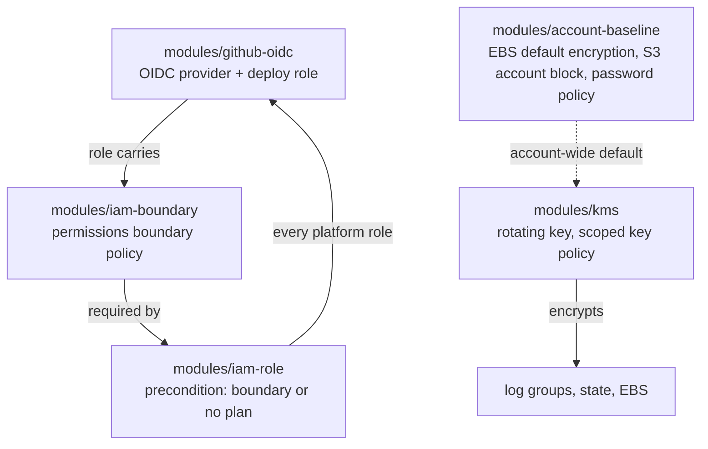

# Milestone M2 recap: Identity and security

## How the pieces fit



Milestone 2 is about who can do what and how data is protected by default. `kms` creates customer-managed
keys that rotate yearly and whose key policy grants each AWS service only what it needs. `github-oidc` lets
CI obtain one-hour credentials with no stored access keys, because the deploy role's trust policy accepts
only tokens GitHub issued for this repository and branch. `iam-boundary` is the ceiling on what any
platform role can do, and `iam-role` refuses at plan time to create a role without it, so a role cannot
sidestep the ceiling. `account-baseline` closes the gaps that apply to the whole account: encrypted EBS
volumes by default, no public S3 buckets, and a sane password policy. All of it runs as the `m2` live-drill
stack.

Latest drill evidence: [m2 on 2026-11-17](../live/2026-11-17-m2-4.md) (M2.1 to M2.3). The account
baseline is applied by the drill that this push starts; its report will be committed to `docs/live/`.

## Ten questions

<details><summary>1. A role has an IAM policy allowing <code>kms:*</code> and still gets AccessDenied on a key. Why?</summary>

The key policy must allow the caller directly or delegate to IAM (an Allow for the account root). Without that statement, identity policies are ignored for that key.

</details>

<details><summary>2. How do you limit a KMS key to one CloudWatch log group?</summary>

A key-policy condition on the encryption context <code>aws:logs:arn</code> naming that log group.

</details>

<details><summary>3. Why is OIDC better than access keys stored in GitHub secrets?</summary>

Credentials are issued per job and expire within an hour, nothing permanent can leak, and AWS accepts only tokens signed for the repository, branch or environment in the trust policy.

</details>

<details><summary>4. Which claim in the GitHub token does the trust policy match, and why exact matching?</summary>

The <code>sub</code> claim (for example <code>repo:owner/repo:ref:refs/heads/main</code>). A loose match such as a wildcard would let other repositories or branches assume the role.

</details>

<details><summary>5. AWS allows one OIDC provider per URL. What follows for a second root module?</summary>

It must not create another one: set <code>create_provider = false</code> or import the existing provider into state.

</details>

<details><summary>6. What is a permissions boundary, and how does it combine with a role's policies?</summary>

A policy that sets the maximum permissions. Effective permissions are the intersection of the identity policies and the boundary. It grants nothing alone.

</details>

<details><summary>7. How do you stop a role that can create roles from escalating?</summary>

Deny <code>iam:CreateRole</code> and <code>iam:PutRolePermissionsBoundary</code> unless the request carries the required boundary, and deny removing boundaries or editing the boundary policy.

</details>

<details><summary>8. Why check for a boundary in Terraform when IAM already denies it?</summary>

A <code>precondition</code> fails at plan time with a clear message. The IAM Deny is the real enforcement, including for roles made by hand.

</details>

<details><summary>9. What does EBS encryption by default not do?</summary>

It does not encrypt existing volumes or other regions; it applies only to volumes created afterwards in the region where it was turned on.

</details>

<details><summary>10. Why set S3 Block Public Access at the account level?</summary>

It overrides every bucket, existing and future, so one mistaken ACL or bucket policy cannot expose data.

</details>

## Apply it for real

You run this yourself, in a sandbox AWS account. Agents in this repo never do. The modules here are
building blocks; the quickest way to see them is the same stack the drill uses.

1. Use credentials for a **non-production** account and `export AWS_REGION=us-east-1`. Beware: the account
   baseline is account-wide, so applying it changes settings for everything in that account.
2. Check what the account already has, because destroy resets rather than restores:
   `aws ec2 get-ebs-encryption-by-default`, `aws s3control get-public-access-block --account-id <your account ID>`
   and `aws iam get-account-password-policy`.
3. Apply the drill stack. It needs a boundary ARN (create one first with `modules/iam-boundary` or use any
   boundary policy you own) and an existing GitHub OIDC provider, or edit `create_provider`:
   ```bash
   cd live/stacks/m2
   terraform init -backend=false   # local state, fine for a sandbox
   terraform apply -var owner=<you> -var permissions_boundary_arn=<boundary policy ARN>
   ```
4. **Console:** KMS → Customer managed keys → `platform-live-logs` (rotation enabled, key policy with the
   CloudWatch Logs statement); IAM → Roles → `platform-live-github-deploy` (trust relationships) and
   `platform-live-worker` (permissions boundary); EC2 → Settings → Data protection and security (EBS
   encryption); S3 → Block Public Access settings for this account; IAM → Account settings (password policy).
5. **Cost, roughly per hour:** a KMS key about $0.0014 (about $1 a month); IAM, the settings and the empty log
   group are free.
6. **Verify:** `aws kms describe-key --key-id alias/platform-live-logs`,
   `aws ec2 get-ebs-encryption-by-default`, `aws iam get-account-password-policy`.
7. **Destroy:** `terraform destroy` with the same variables. The KMS key enters a 7-day deletion window and stops
   billing when deleted. The account settings revert to AWS defaults; re-apply your previous values if you had any.
