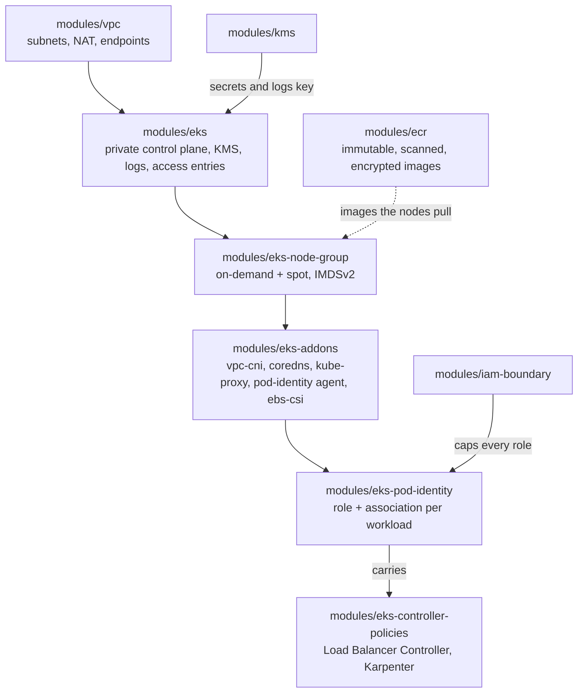

# Milestone M3 recap: Containers and EKS

## How the pieces fit



Milestone 3 turns the network and security foundations into a place to run containers. `ecr` stores images
with immutable tags, scan-on-push and KMS encryption. `eks` creates the Kubernetes control plane that AWS
operates: private endpoint, Secrets encrypted with a customer-managed key, control-plane logs, and access
entries for who may use it. `eks-node-group` adds worker machines (an on-demand group and a tainted spot group)
that require IMDSv2. `eks-addons` installs the pieces that make a cluster usable, with versions pinned.
`eks-pod-identity` gives each workload its own short-lived role instead of sharing the node's, and
`eks-controller-policies` supplies the narrowly scoped policies for the two controllers that most clusters
add next: the Load Balancer Controller and Karpenter. Every role carries the M2 permissions boundary. All of it
runs as the `m3` live-drill stack.

Latest drill evidence: [m3 on 2026-11-24](../live/2026-11-24-m3.md), which covers M3.1 to M3.5 (apply and verified destroy). The M3.6 policies and roles are applied by the drill that this push starts; its report will be committed to `docs/live/`.

## Ten questions

<details><summary>1. Why does the EKS cluster here use a private API endpoint by default?</summary>

The API server then has no internet-facing address; only things inside the VPC (or a VPN or self-hosted runner) can reach it. A public endpoint is optional and restricted by CIDR, which trades convenience for exposure.

</details>

<details><summary>2. What does the <code>access_entries</code> authentication mode change compared with the old <code>aws-auth</code> ConfigMap?</summary>

Who can use the cluster is managed through the EKS API (and so Terraform and IAM) instead of by editing a ConfigMap inside the cluster. The creator also gets no hidden admin rights.

</details>

<details><summary>3. Why is a customer-managed KMS key used for Kubernetes Secrets, and what does the key policy need to allow for the log group?</summary>

Secrets in etcd are then envelope-encrypted with a key you control and can audit. CloudWatch Logs may use the key only for the cluster's own log group, through a condition on the encryption context <code>aws:logs:arn</code>.

</details>

<details><summary>4. What do ECR immutable tags and scan-on-push each protect against?</summary>

Immutable tags stop a tag such as <code>v1</code> from being silently repointed to different content, so what you tested is what runs. Scan-on-push checks each pushed image for known vulnerabilities as soon as it arrives.

</details>

<details><summary>5. Why does the node group's launch template require IMDSv2?</summary>

IMDSv2 needs a session token, which blocks the simple request-forgery attacks that read the instance's credentials from the metadata service. The hop limit also keeps pods from reaching it.

</details>

<details><summary>6. When is a spot node group a good fit, and why is it tainted here?</summary>

For interruptible, restartable work, because spot capacity is cheaper but can be reclaimed at short notice. The taint keeps ordinary pods off it: only pods that tolerate the taint (and the interruption) land there.

</details>

<details><summary>7. Why are add-on versions pinned by a variable instead of left on the default?</summary>

Nobody chose the defaults and they upgrade on AWS's schedule. Pinned versions make an upgrade a reviewed change in code and let <code>OVERWRITE</code> make the cluster match it.

</details>

<details><summary>8. Compare Pod Identity and IRSA in one sentence each, and name a case where IRSA is still needed.</summary>

Pod Identity: an EKS association plus a fixed trust policy on <code>pods.eks.amazonaws.com</code>, delivered by a node agent. IRSA: an OIDC provider per cluster and trust policies that quote it. IRSA is still needed on Fargate or outside EKS.

</details>

<details><summary>9. What stops Karpenter from escalating its privileges through <code>iam:PassRole</code>?</summary>

PassRole names exactly one node role and only to <code>ec2.amazonaws.com</code>, so it cannot launch an instance wearing a more powerful role.

</details>

<details><summary>10. The load balancer controller's policy contains <code>Resource: "*"</code> in places. Where is that unavoidable, and how is the rest limited?</summary>

Describe calls and a few create calls have no resource-level permissions. Mutating statements are conditioned on the cluster tag the controller puts on what it creates, so it can change only its own load balancers and security groups.

</details>

## Apply it for real

You run this yourself, in a sandbox AWS account. Agents in this repo never do. The quickest way to see the
milestone is the same stack the drill uses.

1. Use credentials for a **non-production** account and `export AWS_REGION=us-east-1`. The stack creates an
   EKS cluster, a NAT gateway and an EC2 node, which cost real money while they exist.
2. You need a permissions boundary policy ARN (create one with `modules/iam-boundary` first, or use any
   boundary policy you own). Every role in the stack must carry it.
3. Apply, using local state (fine for a sandbox). The cluster takes about 10 minutes and the whole apply about 18:
   ```bash
   cd live/stacks/m3
   terraform init -backend=false
   terraform apply -var owner=<you> -var permissions_boundary_arn=<boundary policy ARN>
   ```
4. **Console:** EKS → Clusters → `platform-live-eks` (Overview, Networking with the private endpoint, Compute with
   the two node groups, Add-ons, Access → Pod Identity associations for `orders-api`, `aws-load-balancer-controller`
   and `karpenter`); ECR → Repositories (`api`, `worker`); KMS → Customer managed keys; IAM → Policies →
   `platform-live-lb-controller` and `platform-live-karpenter`.
5. **Cost, roughly per hour:** about $0.19: EKS control plane $0.10, NAT gateway $0.045, one `t3.small` node about
   $0.02, plus the node's volume, an Elastic IP in use, and KMS keys prorated (about $0.003 an hour). Everything else is free while empty.
6. **Verify:** `aws eks describe-cluster --name platform-live-eks --query cluster.status`,
   `aws eks list-pod-identity-associations --cluster-name platform-live-eks`,
   `aws iam list-policies --scope Local --query "Policies[?starts_with(PolicyName,'platform-live-')].PolicyName"`.
7. **Destroy:** `terraform destroy` with the same variables (about 6 minutes). Then confirm nothing is left:
   `aws eks list-clusters`, `aws ec2 describe-nat-gateways --filter Name=state,Values=available,pending`, and
   `aws resourcegroupstaggingapi get-resources --tag-filters Key=live-stack,Values=m3` should list nothing. KMS keys remain
   for their 7-day deletion window and stop billing then.
