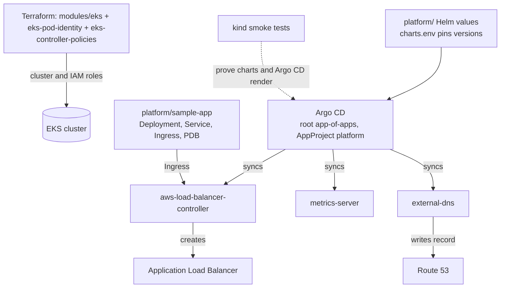

# Milestone M4 recap: Kubernetes platform layer

## How the pieces fit



Terraform (M1 to M3) builds the cluster and the IAM roles; milestone 4 is the Kubernetes side. `platform/` holds
pinned Helm values for three add-ons: the load balancer controller (turns Ingress objects into ALBs), metrics-server
(CPU and memory numbers) and external-dns (DNS records for Ingress hostnames). Argo CD, installed once, watches this
repository and keeps the add-ons in sync through an app-of-apps root. The sample app is the first thing that runs on
top: its Ingress exercises the controller, external-dns publishes its name, and its PodDisruptionBudget keeps node
drains safe. Lint scripts keep versions, values files and manifests from drifting apart, and kind smoke tests (run by
hand, they need Docker) exercise the charts and Argo CD locally.

Latest drill evidence: none specific to M4. This milestone changes no Terraform, so no drill stack applies it; the
cluster and roles it relies on are covered by the [m3 drill on 2026-11-24](../live/2026-11-24-m3.md).

## Ten questions

<details><summary>1. Why pin Helm chart versions in <code>charts.env</code>?</summary>

Without a version Helm installs the newest chart, so two clusters built months apart differ. A pin makes an upgrade a reviewed change.

</details>

<details><summary>2. What does the AWS Load Balancer Controller do, and why does it need IAM permissions?</summary>

It watches Ingress and Service objects and creates ALBs and NLBs in AWS. Those are AWS API calls, so its pod needs a role (via Pod Identity) with a scoped policy.

</details>

<details><summary>3. Why test with kind when it cannot create real load balancers?</summary>

It proves that the charts install and the values are valid, with no cost. What needs real AWS (the ALB itself) is left to a real cluster.

</details>

<details><summary>4. What is the app-of-apps pattern?</summary>

One root Argo CD Application whose folder contains only other Application manifests. Applying the root creates all the others, and adding an add-on is a commit.

</details>

<details><summary>5. What do <code>prune</code> and <code>selfHeal</code> do, and what is the risk?</summary>

Prune deletes cluster objects whose manifests left Git; selfHeal reverts manual edits. Git becomes authoritative, but an accidental deletion or hotfix is undone automatically.

</details>

<details><summary>6. Why a dedicated AppProject instead of <code>default</code>?</summary>

It restricts the repositories an Application may read and the namespaces it may write to, so a mistake has a smaller blast radius.

</details>

<details><summary>7. Why are chart versions written in both <code>charts.env</code> and each Application, and what stops them diverging?</summary>

Argo CD cannot read a shell file. <code>platform/tests/lint.sh</code> fails when they differ.

</details>

<details><summary>8. What does a PodDisruptionBudget protect against?</summary>

Too many voluntary evictions (drains, upgrades, consolidation) at once. It does not cover crashes. <code>minAvailable</code> must stay below the replica count or nodes cannot drain.

</details>

<details><summary>9. Why <code>target-type: ip</code> on the Ingress?</summary>

The ALB sends traffic to pod IPs directly, which works with the VPC CNI and skips a hop through node ports.

</details>

<details><summary>10. Name three hardening settings in the sample app's Deployment and the threat each reduces.</summary>

<code>runAsNonRoot</code> (a compromised app lacks root), <code>readOnlyRootFilesystem</code> (no payload written to disk), dropped capabilities (fewer kernel powers), no service account token (the pod cannot call the Kubernetes API).

</details>

## Apply it for real

You run this yourself. Agents in this repo never do.

**Locally on kind (free).** Needs Docker, kind, helm and kubectl:
```bash
platform/tests/lint.sh
platform/smoke-test.sh            # the three add-ons on a kind cluster, then deletes it
platform/argocd/smoke-test.sh     # Argo CD plus the app-of-apps root (pulls from GitHub; set REPO_URL/REVISION for a fork)
```

**On a real cluster** (for example the `live/stacks/m3` cluster from the M3 recap, a sandbox account only):
1. Fill the per-cluster values: the `REPLACE_ME` parameters in `platform/argocd/apps/` (cluster name, VPC id, hosted zone).
2. Install Argo CD and the root:
   ```bash
   . platform/charts.env
   helm repo add argo https://argoproj.github.io/argo-helm
   helm install argocd argo/argo-cd --version "$ARGOCD_CHART_VERSION" -n argocd --create-namespace -f platform/argocd/values.yaml
   kubectl apply -f platform/argocd/bootstrap/
   ```
3. Build and push the sample app to ECR, set the image tag, `APP_VERSION`, certificate ARN and hostname, then `kubectl apply -f platform/sample-app/k8s/`.
4. **Console:** EC2 → Load Balancers (the ALB the Ingress created, its target group and health checks); Route 53 → the hosted zone (the record external-dns wrote); EKS → the cluster → Resources → Workloads.
5. **Cost, roughly per hour:** the cluster from M3 (about $0.19) plus the ALB (about $0.0225 plus usage). Argo CD and the add-ons add pods but no AWS charges; they use node capacity.
6. **Verify:** `kubectl get applications -n argocd` shows `Synced`; `kubectl get pdb,ingress -n sample-app`; `curl https://<your hostname>/healthz` returns `ok`.
7. **Destroy:** `kubectl delete -f platform/sample-app/k8s/` first and wait until the ALB is gone (`aws elbv2 describe-load-balancers`), because the controller deletes it and Terraform does not know about it. Then delete the Argo CD root and `terraform destroy` the cluster stack. Remove the Route 53 record if external-dns left one.
